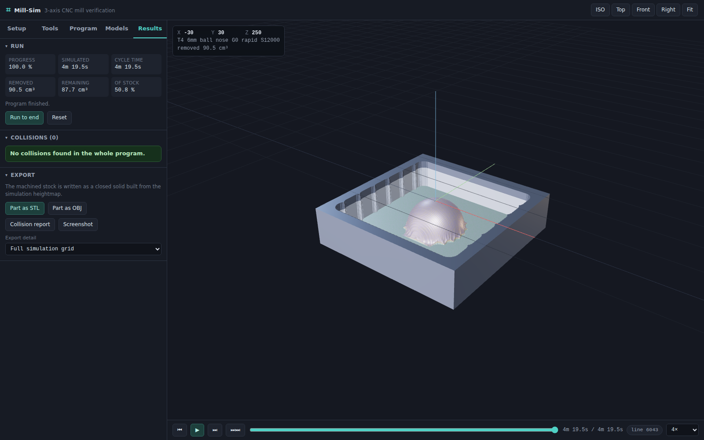

# Mill-Sim

A CNC milling simulator that runs in the browser. Build tools and holders
parametrically, read a G-code program, watch the machine cut a block of
stock, and get told about every crash before the real machine finds it.

No build step, no bundler, no backend. It is plain ES modules plus a
vendored copy of three.js.

## Running it

**No toolchain?** Download [`dist/mill-sim.html`](dist/mill-sim.html) and open
it. That one file is the whole simulator — three.js, every source file, the
stylesheet and all four example programs inlined — so it runs straight off
your filesystem with no install, no server and no Node.

**From source**, which you want if you're going to change anything:

```bash
npm start          # serves on http://localhost:8080
npm test           # 67 unit tests, no browser needed
npm run build      # regenerate dist/mill-sim.html (needs: npm i -D esbuild)
```

There is nothing to `npm install` — the project has no dependencies and
three.js is vendored in `vendor/`. You just need Node 20+.

Serving over HTTP is required when running from source: the app is plain ES
modules, and browsers block module imports over `file://`. Any static server
works — `python3 -m http.server 8080` is fine if you'd rather not use Node.
The single-file build sidesteps this entirely by bundling to one classic
script.

Open the page, pick an example from the **Program** tab, and press play.



---

## What it does

**Parametric tool library.** Eight cutter families — flat, ball, bull nose,
chamfer/V, tapered, drill, face mill and undercut — each generated from its
real dimensions rather than picked from a fixed list. Holders are stacks of
cones running from the nose up to the gauge line, so a stubby shrink-fit
holder and a slim extension behave differently in a deep pocket, as they
should. The taper above the gauge line is deliberately not modelled: it
lives inside the spindle bore and can never touch anything. The gauge line
is the mating face, and the spindle nose starts exactly there. A tool plus a holder plus a stickout is an *assembly*, and
an assembly is what a `T` number selects.

**Millimetres or inches.** **View › Show › Units** switches every length on
every page — the tool library, the machine's travels, the stock, what has
been measured, the readout in the corner — between millimetres and inches.
It is a reading, not a second set of numbers: the job is held in
millimetres whichever way it is set, so a project or a library written in
inch mode is the file that would have been written in metric, and
switching mid-job changes the panels and nothing else. It is also not
G20/G21 — what the numbers in a program mean is the programmer's business,
and a metric program stays metric.

A shop's tools arrive as a file rather than as forty sets of numbers to
retype, so **Tools › Library › Import** reads four kinds directly:

| From | File | Notes |
| --- | --- | --- |
| Mill-Sim | `.json` | What Export writes. |
| Fusion 360 / HSMWorks | `.json`, `.tools`, `.hsmlib` | ISO 13399 geometry, holders, presets, `T` numbers. |
| Siemens NX | `tool_database.dat` and friends | NX's own ASCII library, as it sits on disk under `MACH/resource/library/tool/…`. Pick the unit in the dialog: NX keeps metric and english libraries in separate directories, and the file itself does not say which it is. |
| Anything else | `.csv`, `.tsv`, `.txt` | A tool list with a header row. Columns are matched by meaning, so NX's `FLUTE_LN`, ISO's `LCF` and a plain `Flute Length` all land in the same place. |

For tools that live in a part's CAM setup rather than in the NX library,
`integrations/nx/export_tools_to_mill_sim.py` is an NX Open journal — **Tools
› Journal › Play…** — that walks the setup's tool group and writes a
Mill-Sim library.

It brings the holders and the shanks too. NX describes both the way
Mill-Sim does — a run of sections, each with a lower diameter, an upper
diameter and a length — so a stepped holder and a reduced-neck cutter both
come across as they are. The holder is shared between every tool that runs
in it; the shank belongs to the tool, because it does.

NX states how far a tool is pushed *into* its holder and Mill-Sim asks how
much of it is *out*; one is the overall length less the other, so the
journal converts and the library keeps one number. That reading is checked
rather than trusted — a stickout that would put the holder on the flutes,
or leave the tool held by nothing, is not the right reading of that
number. The assembly window shows both ends of it.

 NX describes a holder the way Mill-Sim does — a
run of steps, each with a lower diameter, an upper diameter and a length —
so the stack comes across as it stands, turned nose-first, shared between
every tool that runs in it, and with the tool's projection as the
stickout. That is the part that usually crashes, so it is worth having.

It does not assume it knows NX Open's spelling. The call that hands you a
tool's parameters has moved between versions and differs between tool
classes, so the journal asks the objects in front of it what they can do:
it looks for anything on the group collection that makes a builder, tries
each in turn, and reads the builder's parameters by matching what it finds
rather than by naming them in advance. Failing all that it falls back to
the UF parameter calls. Either way it writes
`mill-sim-tools-diagnostic.txt` beside the library saying what it found
and what it tried — if a seat still comes up empty, that file names the
call it wants.

`python3 integrations/nx/test_export_logic.py` exercises everything in the
journal that decides something, on a machine with no NX on it.

**G-code interpretation.** A full modal interpreter: linear and helical
arcs in all three planes, both `I/J/K` and `R` forms, inch and metric,
absolute and incremental, work offsets, tool-length offsets, canned
drilling cycles, subprogram calls, and reference returns. It reports what
it could not make sense of instead of quietly doing something else.

**Material removal.** The stock keeps its material along X, Y and Z:
three grids of lines, each line holding the stretches of it that are
inside metal (a *tri-dexel* model). What you see is the surface the tool
actually leaves — scallops from a ball nose stepover, the radius a cutter
leaves in a square corner, the ramp from a helical entry — and also what a
top-down model cannot hold: a hole drilled into the side of a part, a
groove cut by a lollipop under a ledge, a cut a leaning tool makes under
standing metal. A hole from the side is a gap in the lines it runs along
and in every line it crosses; every face of the part is crossed by one of
the three families within 54.7° of square, so walls are seen as well as
floors.

Cutting is solved on each line against the cutter itself — kept as exact
pieces, with a ball nose a true sphere — rather than a faceted copy:
closed form along the tool axis and square to it, a search for a ramp or a
plunge, and fine stamping only for a leaning tool moving along lines at an
angle to it. Against answers worked out by hand: a side hole's volume and
position, two crossing holes against the Steinmetz solid, a lollipop
tunnel, wall positions along X and Y to a tenth of a micron, a 20° leaning
wall, a hole at a compound angle. On a 3-axis job it agrees with the
height-map model it replaced, and where the two differ — the steep flanks
of a ball nose — it is the closer of the two to the exact surface.

It is drawn as the closed surface of what is left. The lines of the three
families cross on one lattice and every edge of it lies on a line, so where
the surface crosses an edge is not estimated: it is the end of a stretch,
where the cutter put it. A vertex goes in each cell the surface passes
through, at the point that best fits the planes of its crossings (dual
contouring), which keeps a floor meeting a wall a sharp corner rather than
a bevel the size of a cell — on a plain block every vertex lies on a face,
and on a slotted one within 0.02 mm of the true part at a 0.25 mm lattice.
The mesh is built in blocks of 32 cells, about 0.8 ms each, and a cut
remakes only the blocks it reached. Being closed, a **View › Inspect ›
Section** through it shows the inside as a solid cut face. Picking
and measuring land on it — a click down a side hole stops at the bottom of
the hole — and **Results › Export › Part as STL** writes it, side holes and
all, as a closed mesh. Past a triangle budget (2.4 million, 600,000 on a
phone) the display uses every second or third line; the export uses every
line unless Export detail says otherwise.

It takes about 3.5 MB per 100,000 lines: under 10 MB for any shipped
example at its own cell, 35 MB for the 120 × 80 bracket at 0.1 mm. The
lines are capped at twelve million, so on a large block the finest cells
are coarsened to fit, and the Stock page says so. In the app, the shipped
examples run to the end in 0.25–1.15 times the time the height map took.

**The height map is retired.** Until v72 the default stock was a height
map — one top surface per XY column — with the tri-dexel as an option.
Every stock is the tri-dexel now and there is no model to choose. A
project saved with `"model3d": "heightmap"` still opens; the field is
passed over. The height-map class (`src/sim/stock.js`) is kept as the
tri-dexel's base, for the grid and the top-down heights it keeps current,
and its own 3-axis kernels stay only for the tests that pin results the
tri-dexel is checked against.

**Stock that is not a block.** **Add stock…** offers three shapes, because
three is what a shop has: a rectangular block (X, Y, Z), a round bar (Ø and
height), and a model — a casting, a forging, a weldment, or the output of
the last operation, imported as STL. A shape is nothing more than the
height each XY column of the stock starts at, and the lines are filled from it:
a block answers "the top, everywhere", a bar answers "the top, inside the
circle", and a model answers with its own upper surface. Everything
downstream works on the lines that fill it, so cutting, collision checking,
volume and the picked surface need to know nothing about which of the three
they are looking at — a facing pass over a Ø50 bar removes the disc, not
the square, and a cut that reaches the bottom leaves a hole rather than a
film. The starting shape cannot hold an undercut: what hides beneath the
top surface of the model is taken to be solid. Undercuts the program cuts
are kept.

**Home, travels and machine coordinates.** Machine zero is a point you give
— typed, or picked — where the spindle face (the gauge line, where the holder
seats) stands with every axis at its home switch, measured from part zero.
Machine coordinates are the spindle face measured from there, whatever tool
is in it: at home they read 0, 0, 0; `G53`, `G28` and the travel limits all
use them, and a tool hangs its own length below. **Machine › Travels** parks
the machine at home with the spindle empty, marks the home point and draws
the box the spindle face can travel in, so the numbers on the page are the
picture on screen. The readout's **MCS** line and the **Jog** sliders read
in the same terms: a slider runs from that axis's minimum to its maximum,
and *All to home* is every slide at 0.

**Collision checking.** Not just the cutter: the shank, the neck, the
holder and the spindle nose are all part of the crash model, along with
imported fixtures, the table surface, the travel limits and the machine
itself. The table checked is the one the machine draws, round platter or
slotted rectangle, and it turns with its axes. The castings are checked
as drawn — the stand-ins' boxes and cylinders, or the triangles of a body
you imported — each moving with the axis that carries it, so a cutter fed
into a trunnion's cradle side, or a long tool swung into a cheek, is a
**Machine collision** naming the part and its axis. And the machine is
checked against itself: whatever rides with the spindle — ram, head,
fork, the spindle housing — against everything else, the platter and the
stock included, so a head brought down beside a trunnion swung to A90 is
reported in the table face. Pairs that already touch with every axis at
zero are how the machine is built (a bridge on its walls, a slide on its
ways) and are never reported. **Machine › Travels › Check the castings**
turns both off. **Setup ›
Checks** decides what counts: ask for clearance and a pass that clears a
clamp by 2 mm is reported as the near miss it is, rather than only metal
in metal. Which parts of the assembly are checked at all is a switch, and
two exceptions live on the fixture itself — a soft jaw being cut can be
ignored, a fragile one can ask for more room than everything else.

**Macros, in whatever the control spells.** Variables, arithmetic and
control flow, because that is what the programs in a real control's memory
are made of:

```gcode
#1 = 0
WHILE [#1 LT #2] DO 1
  #10 = #3 * COS[360 * #1 / #2]
  #11 = #3 * SIN[360 * #1 / #2]
  G0 X#10 Y#11
  G83 Z-12. R2. Q3. F180
  #1 = #1 + 1
END 1
```

That is Fanuc's spelling. It is not *the* spelling — Siemens writes the
same job like this:

```gcode
R1 = 0
WHILE R1 < R21
  R4 = 360. * R3 / R21
  G0 X=R20 * COS(R4) Y=R20 * SIN(R4)
  R1 = R1 + 1
ENDWHILE
```

so the syntax is a table rather than an assumption: which character marks
a variable (`#`) or which letter introduces one (`R`, `Q`, `V`), which
brackets group an expression, how the six comparisons are spelled, what
the control-flow words are called, whether a jump goes to a line number or
a named label, whether values are written `X100` or `X=100`, whether a
variable is local to a macro call, and — the one that bites — whether
round brackets are arithmetic or a remark. Get that last one wrong and
`X=SIN(30)` becomes a comment.

**Machine › Macros › Reads like** picks the table: Fanuc (also Haas, Mazak
and Fadal), Siemens 840D, Heidenhain Q parameters, Okuma V. **Edit
syntax…** changes any of it, which is how a control nobody here has ever
seen gets described rather than waited for — give it an `@` sigil and
`LOOP … ENDLOOP` and it reads that from the next block on. The table is
saved with the machine, so a program that moves between machines is read
by each of them the way that machine would read it.

Underneath, all of them get the same thing: assignment and arithmetic with
the usual precedence and the usual functions (in degrees, like the
control), an expression anywhere a number goes, conditional jumps and
assignments, `WHILE` loops, `FOR` and `REPEAT` on the controls that have
them, and macro calls whose letters arrive as arguments. A program that
uses none of it is read exactly as it was before.

On a Siemens a program also names its own variables, and the reader runs
them the way the control does:

```gcode
DEF REAL DEPTH=6, STEP=1.5, ZZ
DEF INT PASSES=0
DEF REAL CORNER[2]=SET(-20, 15)
DEF STRING[16] OP="ROUGH"
ZZ = ZZ - STEP
PASSES = PASSES + 1
G1 X=CORNER[0] Z=ZZ F300
IF OP=="ROUGH" GOTOF NEXT
```

`REAL`, `INT` (rounded half away from zero, as the control does), `BOOL`
with `TRUE`/`FALSE`, `STRING` and `CHAR`, arrays of one or two dimensions
counted from zero and checked against their size, and a scope per
subprogram call, so a subprogram's `DEF` is its own and goes when it
returns. A name the program does not declare is the control's global user
data: the reader takes it from the machine's named parameters on
**Machine › Macros**, so `G0 Z=SAFEZ` reads the machine's `SAFEZ`. A
name that is neither says so, on its line.

The numbered ones are kept the way each control keeps them. A Fanuc — and
a Mazak or Haas reading ISO — has `#1`–`#33` for each macro call and one
set for the main program, `#100`–`#199` shared and lost at power off,
`#500`–`#999` shared and kept, and `#1000` up for the control's own state;
`#0` is always empty, `#50` is not a variable at all and is reported as
the alarm it is, and `#3000 = 1` stops the run with alarm 3001 the way the
machine does. A Fidia has two banks of a hundred, `RG 0`–`RG 99` and
`PT 0`–`PT 99`, and `PT 5` is not `RG 5`. Siemens `R`, Heidenhain `Q` and
Okuma `V`/`VC` are banks of their own too.

**Program › Variables** follows all of them through the run — the
program's own, the `R`/`#` parameters and the machine data it read — with
the value in force on the move the machine is on, the line that last set
it, and the whole history of each one a click away; a line in that
history takes the run there. Rows the blocks just before this move
changed are lit. Pin one with the star and it rides on the readout over
the viewport, so `PASSES` and `ZZ` can be watched while the cut plays.
Under **Starting values** the page also holds what the control has before
the program starts — `#500` with last shift's part count, `RG50` with the
item number the operator dialled in — kept with the machine, so the
program branches the way it will on the floor. What the variables came to
at the end is also on **Program › Summary**,
which is the first place to look when a macro program lands somewhere
odd.

**Measuring.** A verifier that cannot answer "how deep is that pocket" is
asking to be trusted and checked somewhere else. **View › Measure** takes
two points for a distance, with its three components, or three points
round a bore for its diameter and centre. Points snap to corners, edges,
face centres, work origins — and to the rim of whatever has been cut,
which is what makes a bore measurable from above: its top edge is the
easiest part of it to point at. A Ø10 hole on a
0.28 mm grid measures Ø10.045.

**Five-axis machines.** A machine is a tree of joints rather than a fixed
layout, so head-head, head-table and table-table are the same code with the
rotaries in different places. Start from a preset, move a pivot, slave one
axis to another, and hang your own STL castings on each axis. The tilted
work-plane and tool-centre-point codes are interpreted, the tool is carved
at whatever angle the machine puts it, and the rig in the viewport moves the
way the real machine does.

**Assembling a machine.** Start from a preset, or from **New machine…** —
a base that does not move, a table to clamp to, a spindle to hang the tool
on, and no axes. Add the axes on the Axes page, then bring the machine in
as STL bodies on the Assembly page and say which axis carries each one. A
body on the base never moves; a body on X rides the X slide; an axis can
carry as many bodies as it has castings. **Mate by two points** does the
placing: click a point on the body, click where that point belongs, and it
moves so the two coincide — joints snap as targets, so a casting drops
straight onto its own pivot. The move is measured in the frame of the axis
that carries it, so a saddle nudged 20 mm has moved 20 mm along its own
slide whatever the rest of the machine is doing.

**The controller** is part of the machine too. Controls do not agree on the
modal state they power up in, and a program posted for one machine read by
another is the classic way to crash — the second one starts in inches, or
reads I/J as absolute, or comes up in G18. The Controller page holds those
defaults and changing one re-reads the program.

**Macros: what the machine does at an M code.** A control does not really
*do* M06. It runs a program the machine builder wrote, which retracts the
head, crosses to the change position, unclamps and indexes the carousel —
which is why two machines reading the same G-code visibly do different
things at the same code. **Machine › Macros** holds those programs, as
G-code:

```gcode
(KR199 tool change: square the head, cross to the changer)
M5
G91 G28 Z0
G90 G53 G0 C0 A0
G53 G0 X#toolChangeX Y#toolChangeY
G4 P3.0            (arm swings)
```

`#toolChangeX` is a machine parameter, set in the same place; `#T`, `#S`,
`#P`, `#Q`, `#R`, `#H` and `#D` are the words of the block that called the
macro, so the body can say which tool it is loading. Everything else is
ordinary G-code read by the ordinary interpreter, so G28, G53, dwells and
canned cycles all work inside one. They ship switched off: a macro that
runs changes what every program does at that code, and that should be a
decision rather than a surprise.

The same page holds the **subprograms that live in the machine** — probing
cycles, pallet routines, the builder's own O9000 programs, the files that
stay in the control between jobs. Any program loaded on the machine can
call them with M98 without carrying a copy, and they are saved and loaded
with the machine, because they are part of it.

**Subprograms that belong to the job** are on **Program › Subprograms**,
and they are files, nothing more: open one or several the same way the main
program is opened, edit them in the same editor. The number M98 asks for is
the `O` word at the top of the file, exactly as a control reads it — rename
the file however you like. The moves inside a subprogram are simulated,
carved and collision-checked like any others, and the toolpath and every
warning say which file they came from. Two files claiming the same O number
is reported rather than quietly resolved. A program that carries its own
O-numbered sections still works exactly as it did.

**The job as one file.** A setup is not a program: it is a program, the
machine it runs on, the stock it starts from, where that stock sits
against the work offsets, which tools the T numbers mean, and the clamps
standing around it. **Setup › Project** saves all of it as one zip —
`project.json` for the setup, `program/` for the G-code and its
subprograms, `machine/` laid out exactly as **Save machine** writes it,
`library.json` for the tools, `models/` and `stock/` as STL. Opening one
puts it back in the order the thing itself requires, camera included.
Every part of it opens in something else: a project only this program can
read is a hostage, not an archive.

Your own machine goes in through **Machine › Layout › Load machine…**, and
comes out through **Save machine…** as a folder — a `.zip`, because a web
page cannot hand you a directory, and every operating system opens one as a
folder anyway:

```
fidia-kr199.zip
├── machine.json     the chain; the controller's power-up state; the
│                    travels, table, spindle nose and rates; where home is;
│                    the macro and subprogram list; and which axis carries
│                    each body, and where
├── macros/M6.nc     one file per macro, plain G-code
├── macros/M30.nc
├── subprograms/     the files that live in this control between jobs
├── bodies/*.stl     the castings themselves, in millimetres
└── README.txt
```

Everything on the Machine tab is in there, geometry included: load the
folder on another computer and you have the same machine, with the same
envelope, the same crash model and the same idea of what M06 does. The two
exceptions are deliberate — whether the full machine is *drawn*, and which
preset it started life as, are about the window rather than the machine.
`examples/machines/fidia-kr199.json` is a worked example of the JSON on its
own — a bridge machine with a fixed table and an A/C birotary head, X Y Z C
A all in series, with its tool-change macro — to copy and edit; loading a
bare `.json` like that restores the arrangement and asks for the STLs
separately.

Until you import castings, each preset draws itself: a plinth with a chip
skirt, a column with ways down its front face, a T-slotted table on a
saddle, telescoping way covers, a trunnion with two cheeks and a cradle
between them, a fork head with its tilt bearings. They are coloured by what
a part *does* — everything that slides one colour, everything that rotates
another, the spindle bright because it is the bit you watch — and each
machine family paints its moving castings its own colour. A machine you
cannot read is a machine you cannot check a program against.

**Models in and out.** Import STL fixtures, clamps and reference parts,
place them with a gizmo or by typing coordinates, and export the machined
part as STL or OBJ when the run finishes.

---

## Getting around

One rule decides where everything lives:

> **The ribbon navigates. The side panel acts.**

The tabs across the top say which part of the job you are working on, and
the row under them says which page of it. Neither ever *does* anything —
clicking a page changes what the side panel shows, and that is all. Every
control that changes something lives in the panel, next to the thing it
changes, so no button is ever in two places and there is only one place to
look for it. Double-click a tab, or use the chevron on the right, to
collapse the page row and give the viewport the space back.

| Tab | Pages |
| --- | --- |
| **Setup** | Project · Stock · Work offsets · Fixtures · Checks |
| **Machine** | Layout · Axes · Assembly · Controller · Macros · Travels |
| **Tools** | Tool table · Cutters · Holders · Library |
| **Program** | Main · Programs · Variables · Summary |
| **Results** | Findings · Compare · Export |
| **View** | Camera · Show · Inspect · Measure |

The panels say little until asked: a section with more to explain than
its controls do carries a small **i** beside its title, and the
explanation opens under it. Status — a file name, a count, a warning —
is always shown.

Drag the side panel's right edge to make it wider or narrower (the arrow
keys do the same once the edge has focus); double-click the edge to put
the width back. The width is remembered in the browser.

**View › Inspect › Section** cuts the part open on a plane square to X, Y
or Z: the slider moves the plane through the stock, and **Flip** keeps the
other side. Both stock models are closed solids, so what shows through the
opening is drawn as the cut face — flat, lit as the plane, in its own
colour — and a hole or pocket the plane passes through shows as a gap in
it.

The viewport draws **on demand**. A machining simulator is static most of
the time — the program is not running, nobody is dragging the view, and the
picture is the same one it was a second ago. Redrawing it sixty times a
second anyway costs a whole core, which a desktop absorbs and a laptop
turns into fan noise. So the renderer runs when something says it needs to:
a change anywhere in the app, the orbit controls while they move, or the
simulator while it cuts. Idle is zero frames a second.

**Background** is a setting, on View › Show. A pale part on a pale ground
has no silhouette, and a machined face reads by its silhouette before
anything else, so the default puts a mid grey-blue behind the work and
there is a dark ground for inspecting a bright finish, a blueprint blue, a
paper white for screenshots, and a colour picker.

Anything that has to be created from nothing is behind an **Add** button at
the top of the page that lists it, and Add always opens a window: a cutter,
a holder, an assembly, a fixture, an axis, a casting. A window is a task
with a beginning and an end — fill it in, watch the preview redraw as you
type, then commit or cancel. Nothing changes until you commit, so Escape is
always safe. Everything else is editing something that already exists, and
that happens in the panel directly.

Playback is the one thing that is neither: the bar under the viewport is
always visible and owns ⏮ ▶ ⏭ ⏭⏭, the scrubber and the speed, so it is
never repeated in a panel.

**⏭ is single block**: each press runs the next block of the program and
stops. A move goes to its end point; a canned cycle runs all of its moves,
because it is one block; `S6000 M3` or `#100 = 5` moves nothing and still
takes its press, as on the control, with the line lit in the editor and
**Program › Variables** showing what it changed. Inside a loop it is the
next pass; at a call, the first line of the called file. Paused part way
along a move, the next press finishes that line. `Shift+→` steps one move
instead.

**M00** and **M01** on the bar are the stop switches. With M00 on — the
default, because the machine always stops there — playing halts at an
`M00` block and waits for ▶; with M01 on, so does `M01`, as with the
optional-stop switch on the control. The bar says which stop it is
waiting at and the note says what the line says beside it, which is
usually why the stop is there: `M00 (TURN THE PART OVER)`. ⏭⏭ and the
scrubber run straight through. The switches stay where you leave them.

Keyboard: `Space` play/pause, `R` reset, `→` next line (single block),
`Shift+→` one move, `F` fit view.
During a placement: `X` / `Y` / `Z` lock the move to an axis, `Esc` cancels.

## Placing things by clicking

Typing coordinates to position a vice is a bad way to set up a job. Every
placement tool here is the same conversation instead — click the point, click
where it should go:

- **Move stock** and **Move model** translate the thing so the first point
  lands on the second.
- **Set zero** drops the active work origin straight onto a clicked point;
  **Move G54** shifts it by the distance between two points.

Points snap. Everything near the cursor is projected to the screen and the
closest candidate within a few pixels wins, ranked so a corner beats an edge
and an edge beats a face:

| Colour | Snaps to |
| --- | --- |
| Amber | Block corners and mesh vertices |
| Green | Edge midpoints |
| Blue | Face centres and triangle centroids |
| Purple | Existing work origins |
| Grey | Anywhere on a surface, unsnapped |

The stock snaps to its 26 box features and to the machined surface itself —
the floor of a pocket and the bottom of a side hole are clickable, because
the ray is walked through the stock's lines rather than against the mesh.

Press `X`, `Y` or `Z` mid-move to lock to one axis, which is how you say "up
40" without hunting for a point that happens to be straight above. Clicking
empty space during a move lands on the plane through the start point rather
than throwing the destination across the room.

---

## How the cutting works

Every solid of revolution in the simulator — cutter, neck, shank, holder,
spindle nose — is described by a silhouette polyline of `{radius, height}`
points. From that, `src/tools/envelope.js` builds a **lower envelope**
table: for a point at radial distance `r` from the tool axis, the lowest
height at which that solid occupies that radius.

The cutting itself works from exact pieces (`src/tools/profile.js`): the
cutter as lines and spheres, a ball nose a true sphere. The envelope table
is what the collision probes use for the non-cutting body — neck, shank,
holder, spindle — against the material.

The stock is three grids of lines, one along each axis, on one lattice
(`src/sim/triDexel.js`). Each line holds the stretches of it that are inside
metal, `[in, out], [in, out], …`, in single precision against the stock's
origin. Cutting asks every line the same question — where does it go into
the swept cutter and where does it come out — and since every cutter here
is convex, that is one interval:

```
along the tool axis      the lowest and highest the swept tool reaches on the
                         line: a search over the move on the profile's tables
square to the tool axis  the line lies in one slice of the tool, a disc;
                         moving straight it sweeps a capsule — closed form; a
                         plunge widens it to the widest the tool gets; a ramp
                         is searched
at any other angle       the tool at one position, solved exactly against its
                         pieces; the move is stamped
```

Subtracting that interval from the line's stretches is a merge of two sorted
lists. Lines a move cannot reach are never visited.

The highest material on each Z line is kept as a top-down grid as well, and
a 16×16 tile pyramid holds the maximum of each block, so air moves — most of
every program — are rejected without touching a line. The top-down grid is
also what snapping, the force model and the reference compare read.

The simulator is time-sliced: `run(dt, budgetMs)` does as much work as fits
in a frame and returns, so the UI stays responsive whether the program has
80 moves or 80,000.

### When the tool leans

A leaning tool moving along the tool axis or square to it is still solved in
closed form or by a search on each line. Moving at an angle to the lines, it
is stamped at a spacing taken from the cusp it would leave — a few tenths of
a micron — and capped so the swing between stamps cannot step down a wall.
Because the material is kept along all three axes, a tilted tool passing
under standing metal removes what it passes through and leaves what is over
it. Validated against shapes worked out by hand: a 20° leaning wall, a hole
at a compound angle, a lollipop tunnel under the surface.

### Kinematics

A machine is a tree of joints rooted at the base. Two paths lead away from
it, one ending at the spindle and one at the table, and which path a rotary
sits on is the entire difference between the three families:

| | |
| --- | --- |
| **head-head** | both rotaries on the spindle path — a gantry |
| **head-table** | one on each — the classic 5-axis conversion of a VMC |
| **table-table** | both on the table path — a trunnion |

There is no separate code for the three, only different trees. What the
simulator asks for is the tool expressed in the workpiece's frame,
`inverse(workChain) · toolChain`, which gives a tip and a direction and
nothing about how many axes produced them.

Two inverse problems come up. Tool centre point control needs the linear
axes that put the tip on a given point: with the rotaries fixed the tip
depends on X/Y/Z through a pure translation chain, so the map is affine, and
sampling it at the origin and three unit steps recovers it exactly — the
solve is then one 3×3 system, no iteration. `G53.1` needs the rotaries that
point the tool along a given direction, which is trigonometric and wound
differently by every machine; that one is searched, coarsely then by pattern
search, staying inside the travel throughout so it can report "cannot reach"
rather than a pose the machine cannot make.

### Gouging

Import a model as a **reference part** and it becomes the shape the job is
supposed to produce, and the run is checked against it as it cuts: cut into
it by more than the tolerance and it is reported as a gouge, with its
depth, alongside the collisions.

From above, its top is rasterised onto the stock's grid and every Z line
whose top comes down is compared with it — one array read inside the
carving loop. A closed model is also asked along the stock's own lines:
the first time a line is cut, the part is cast along it once and its solid
stretches kept, and every stretch the cut removes is set against them. A
point that deep along one line need not be deep at all — a line running
just inside a wall is inside it end to end — so the deepest candidates are
bounded along the other two axes as well and only the deepest few are
measured to the part's surface. That is how a Ø10 cutter in a hole the
part wants at Ø9.4 is reported as the 0.30 mm gouge it is, on the line
that drilled it, though no top changed.

The Results panel also reports the other half of the comparison — how much
stock is still standing above the part, and what fraction of the reference
surface was gouged. The tolerance is adjustable; the default is 0.02 mm.

**View › Inspect › Deviation map** colours the stock by it: green on size,
blue for stock still to come off, red for a cut past the part, each
deepening to full colour at a range you set. The distance is the shortest
one to the part, in any direction, and which side of it a point is on is
asked of the part itself — a closed model is a solid, and a point is
inside it when a ray from it crosses its skin an odd number of times; an
open sheet of faces has only a top. Every face of the stock is
judged where it is — the walls and floor of a side hole, the roof of an
undercut, the underside of a ledge — vertex by vertex, and a cut remeasures
only the blocks it reached. Against a reference whose side hole is Ø10.6,
the wall of the Ø10 hole that was drilled reads +0.30 all the way round.

**Pick points** (on the map's key, or View › Inspect) pins readings on the
part: click a spot and it is labelled with how much is left there or how
deep it is gouged, and listed under the key. A reading is a line of sight,
not a fixed point: as the program runs and the spot is cut away, it reads
wherever that line meets the surface now, so a probe on a raw top reads
+0.8 before the facing pass and −0.2 after one that went too deep. The
same measure gives the reading under the pointer.

### What the crash model catches

| Reported as | Meaning |
| --- | --- |
| **Rapid into material** | A `G0` removed material. On the machine that is a crash, not a cut. |
| **Depth of cut exceeds flute length** | Material stands above the top of the flutes inside the cutter's own footprint — the shank is dragging in the cut. Caught even for a plain end mill whose shank is exactly its cutting diameter. |
| **Holder / shank crash** | The holder or spindle nose is buried in the stock, with the depth. |
| **Fixture collision** | Any part of the assembly reached into a fixture or clamp. |
| **Table collision** | The assembly went below the table surface inside its footprint. |
| **Machine collision** | The assembly met one of the machine's castings — a cradle, a cheek, a column, an imported body — or a casting riding with the spindle met the table, another casting or the stock. Both parts are named, with the axes they ride on. |
| **Travel limit exceeded** | The tool tip left the machine envelope. |
| **Gouge into the reference part** | The cutter went into the reference part by more than the tolerance — measured to the part's nearest face, so a gouge in a wall or the side of a hole is as deep as it really is. |
| **Cutting with spindle stopped** | Material removed with no `M03`/`M04` active. |
| **No tool assembly loaded** | The program selected a `T` number the library has no assembly for. |

The interpreter adds its own notes: a `G43 H` that does not match the
active `T`, an arc whose end point misses the programmed radius, an
`R`-format arc smaller than half its chord, cutter compensation that is
acknowledged but not applied, and macro variables it cannot evaluate.

---

## G-code support

**Motion** `G00` `G01` `G02` `G03` — arcs by `I/J/K` (incremental or
absolute via `G90.1`/`G91.1`) or by `R`, including full circles and helical
interpolation.

**Planes** `G17` `G18` `G19` · **Units** `G20` `G21` · **Distance** `G90`
`G91`

**Offsets** `G54`–`G59`, `G10 L2 P`, `G92`/`G92.1`, `G43`/`G44`/`G49` with
`H`, `G53` machine coordinates

**Cycles** `G73` `G81` `G82` `G83` `G84` `G85` `G89` `G80`, with `G98`/`G99`
return planes, `Q` pecks, `P` dwells and `L` repeats

**Five axis** `G68.2` tilted work plane (`P1` Euler ZXZ, `P2` roll-pitch-yaw),
`G69` cancel, `G53.1` orient the tool normal to the plane, `G43.4`/`G43.5`
tool centre point control, and `A`/`B`/`C` words on any move

**How long a move takes** counts every axis it moves. A `G0` takes as long
as its slowest axis: the linear ones at the rapid rate, the rotaries at the
rotary rapid (**Machine › Travels**, 7200°/min by default), so a head
swinging 90° with the tip standing still takes 0.75 s, not no time. Under
`G94`, `F` alone on a rotary is degrees a minute; with linear axes too, a
Fanuc runs it along all of them together (degrees counted as millimetres)
and Siemens, Heidenhain and Fidia along the linear path, as does any control
under tool centre point. `G93` is the program's own time. Whatever `F`
says, no rotary turns faster than its rotary rapid.

**Other** `G04` dwell, `G28`/`G30` reference return, `G40`–`G42`,
`G61`/`G64`, `G93`/`G94`/`G95`

**M codes** `M00` `M01` `M02` `M03` `M04` `M05` `M06` `M07` `M08` `M09`
`M30`, and `M98`/`M99` subprogram calls with `L` repeats

**Syntax** `%` markers, `O` numbers, `N` line numbers, `( )` and `;`
comments, `/` block delete

**Siemens 840D sl**, on a machine set to read Siemens:

- *Frames* — `TRANS`/`ATRANS` shift the program's zero, `ROT`/`AROT` turn it
  (`ROT X Y Z` is Z, then Y, then X; `RPL=` turns in the working plane).
  The plain forms replace the frame; with nothing after them they clear it,
  which is what `ROT` on its own line is for. `SCALE` and `MIRROR` are
  named and not applied.
- *Swivel* — `CYCLE800(_FR, _TC, _ST, _MODE, _X0, _Y0, _Z0, _A, _B, _C,
  _X1, _Y1, _Z1, _DIR, …)`: angles axis by axis (`_MODE` gives the order, 57
  being X then Y then Z), as a solid angle, or as the rotary positions
  themselves; shifts before and after the turn; `_ST 1` adds to the plane
  already there; `_FR` retracts Z (and X, Y) first; `_DIR 0` turns the
  plane without swinging. The retract and the swing are made with the
  slides, as the cycle does, and inside the swivelled plane the tip is
  what is programmed. `CYCLE800()` takes the plane away.
- *Modes* — `TRAORI`/`TRAFOOF` tool centre point on and off, `DIAMOF`
  (`DIAMON` is noted: diameter programming is for turning), and `SUPA`,
  `G153`, `G500`, `G70`/`G71`, the smoothing modes and `CYCLE832` read and
  passed over.
- *Drilling cycles* — `CYCLE81` `CYCLE82` `CYCLE83` `CYCLE84` `CYCLE840`
  `CYCLE85` `CYCLE86` `CYCLE87` `CYCLE88` `CYCLE89` with their positional
  parameters (`RTP, RFP, SDIS, DP, DPR, …`, empty slots taking the default),
  at the tool or, after `MCALL CYCLE…(…)`, at every position that follows
  until `MCALL` alone. Deep-hole strokes shrink by `DAM` and break or clear
  the chip by `VARI`; tapping runs at the pitch (`PIT`, or `MPIT`'s metric
  size) times the speed; `CYCLE86` lifts off the wall by `RPA/RPO/RPAP`.
  In a swivelled plane they drill down the plane's own Z.
- *Tools* — `T` comes before `M6`, by number or by name (`T="10 flat"`),
  and `M6` alone changes to it. A name is matched against the assemblies'
  names, with or without their `T1 · ` in front, and their tools' names.
- *Fixed point* — `G75 FP=1 Z1` sends the axes it names home at rapid,
  straight there; `G74` the same for the reference point.
- *Axis values with a mode* — `C=DC(90)` the shorter way round,
  `ACP`/`ACN` forwards or backwards to the position, `X=AC(…)`/`X=IC(…)`
  absolute or incremental whatever `G90`/`G91` says.
- *Sections* — a label ends in a colon. `REPEAT LABEL P=n` runs the lines
  from the label to `ENDLABEL:` (or, the label being above, down to the
  `REPEAT`), `REPEAT START END` between two labels, `REPEATB` one block,
  and the program carries on after the `REPEAT`.

Other Siemens cycles (`POCKET3`, `CYCLE61`, …) are named once and produce no
toolpath.

**Macros** are read in each control's own spelling — Fanuc `#` variables
and `WHILE`/`IF`, Siemens `R` parameters, `DEF` variables and
`FOR`/`WHILE`/`REPEAT`, Heidenhain `Q`, Fidia `RG`/`PT`; see *Macros, in
whatever the control spells* above.

Not supported: cutter radius compensation as an actual path offset. It is
reported rather than silently ignored.

---

## Honest limitations

- **The gouge check during the run needs a closed reference for 3D.**
  Against a closed model every cut is checked along all three families of
  lines, so a gouge in the wall of a side hole is reported while the
  program runs. An open sheet of faces has only a top, and is checked from
  above.
- **A leaning tool moving at an angle to the lines is stamped** rather
  than solving it exactly.
- **The surface is as fine as its lattice.** A fin or a slot thinner
  than one cell of the displayed lattice can fall between its points and
  not be drawn, though the lines still hold it and the volumes count it.
- **Fixture collision uses each model's oriented bounding box.** A complex
  clamp will read as a slightly bigger block than it is. Import an awkward
  fixture as a few simple pieces for a tighter fit.
- **The machine against itself is sampled.** Where two castings could
  touch, the surface of each inside the other's box is sampled — two dozen
  points across the overlap, never finer than half a millimetre — and each
  sample measured exactly against the other, so a glancing touch thinner
  than the sampling can be missed. Castings that do not ride with the
  spindle are not checked against each other (a cradle swung into a cheek
  is not reported), and two imported meshes only know they touch, not by
  how much.
- **A casting's cylinders and imported meshes are met by spheres.** Boxes
  are measured exactly against an upright tool, as fixtures are; against a
  cylinder or a mesh the tool is a chain of spheres, which reaches up to a
  radius past a flat end and so errs towards a crash. A mesh is measured to
  its skin, so a tool that jumped wholly inside a body between two poses a
  millimetre and a half apart would not be seen.
- **Non-TCP five-axis programs assume the work offset was set with every
  rotary at zero.** Without `G43.4` the programmed X/Y/Z are where the
  linear axes go, and a rotary turns the part under them without moving
  them — `A-90` on its own swings the trunnion and nothing else. Mill-Sim
  measures those axes so that with the rotaries at zero the tip is on the
  programmed point of the part, where the part is drawn on the table, and
  the rotaries then turn it about their real pivots. A post that assumed a
  different part zero relative to the pivot will cut somewhere else here,
  as it would on the machine. Under `G43.4`/`G43.5` there is nothing to
  assume: the programmed point is the tip.
- **Cutter compensation is not applied.** The simulated path is the
  programmed centreline, which is what most posted CAM output already is.
- **Feed rates are taken from the program**, not from any cutting model.
  The reference cutting data stored on each tool is for your own notes.

---

## Layout

```
index.html            page shell, import map, WebGL2 check
styles/app.css        the whole stylesheet
src/
  core/
    util.js           formatting and small helpers
    mat4.js           4x4 maths, dependency-free so kinematics tests run in Node
  tools/
    envelope.js       lower-envelope tables — the geometric core
    toolDefs.js       parametric cutters
    holderDefs.js     parametric holders, nose to gauge line
    assembly.js       cutter + holder + stickout -> cut/shank/holder envelopes
    library.js        CRUD, localStorage, JSON import/export
  machine/
    kinematics.js     the joint tree, forward kinematics and both IK solves
    presets.js        3-axis VMC, head-head, head-table, table-table
    parts.js          the machine's own bodies and where each one sits
  gcode/
    lexer.js          tokeniser
    interpreter.js    modal state machine -> flat move list
  sim/
    stock.js          the grid, top-down heights and tile pyramid (its own
                      height-map carving is deprecated, kept for tests)
    triDexel.js       the stock: material along X, Y and Z
    dexelMesh.js      its closed surface, by dual contouring on the line crossings
    target.js         reference-part rasterisation and gouge comparison
    collision.js      sphere chains vs boxes, table and limits
    simulator.js      the time-sliced run loop
  scene/
    viewer.js         renderer, camera, lighting
    stockView.js      the stock as the app sees it: colours, deviation, section
    dexelView.js      the stock's surface, block by block, with section caps
    toolView.js       lathed assemblies with helical flutes
    toolpathView.js   backplot
    machineView.js    the chain-driven rig: one group per axis
    castings.js       proxy machine parts, and the palette they use
    backgrounds.js    viewport backdrops
    modelsView.js     imported models and the transform gizmo
    pickController.js raycasting and snapping for click-to-place
    originView.js     work-origin markers
  io/
    stl.js            STL read/write, OBJ write
    mesh.js           stock, lathe and box triangulation
  ui/
    ribbon.js         tabs and pages — navigation only, no actions
    panel.js          the shape every side panel has: pages, Add bars,
                      action rows
    dialog.js         the windows Add opens
    toolDialogs.js    cutter, holder and assembly editors
    setupDialogs.js   the Add-a-fixture window
    machineDialogs.js the Add-an-axis and Add-a-casting windows
    icons.js          the stroked icon set
    ...               panels, G-code editor, preview, DOM helpers
  app.js              state, wiring and the frame loop
examples/             the seven example programs
  machines/           a worked machine definition to copy
scripts/              static server, smoke test, single-file build
test/                 unit tests (node --test)
dist/mill-sim.html    self-contained build, committed so it can just be opened
vendor/three/         three.js r180, MIT
```

Everything under `src/core`, `src/tools`, `src/gcode`, `src/sim`,
`src/machine/kinematics.js` and `src/io` is free of three.js, which is why the test suite runs in plain
Node with no browser and no mocks.

### Rendering the cut

Rebuilding a million-triangle mesh every frame would not keep up, so the
stock's surface is built in blocks of 32 cells and a cut remakes only the
blocks it reached. While the program plays, a few blocks are remade each
frame — enough to follow the cutter — and the rest follow when the run
stops.

---

## Testing

```bash
npm test           # unit tests: geometry, G-code, kinematics, cutting, I/O
npm run smoke      # optional: boots the app in headless Chromium
```

The unit tests check real numbers, not just that nothing threw: facing a
block removes exactly the swept volume, a ball nose matches its analytic
sphere, a `G2` the long way round is 270° and not 90°, `G83` pecks land on
the right depths, the exported STL is closed with outward-facing normals,
and scrubbing backwards and forwards again lands on the identical result.

`npm run smoke` needs Playwright, which is not a dependency:

```bash
npm i -D playwright && npx playwright install chromium
npm run smoke
```

It boots the app, runs the demo bracket end to end and asserts it comes out
clean, then runs the deliberately bad example and asserts every mistake in
it is caught, and goes on through every shipped example and most of the
pages. Its browser draws on the CPU, so it opens the app with `?tris=300000`
— a phone-sized budget for the stock's surface — which keeps a run to a
couple of minutes. The same parameter works in any browser.

---

## Requirements

A browser with WebGL2 — Chrome, Edge, Firefox or Safari 15+. The page
checks and says so plainly if not.

three.js r180 is vendored under `vendor/three/` (MIT, license included).
Nothing else is fetched at runtime.
